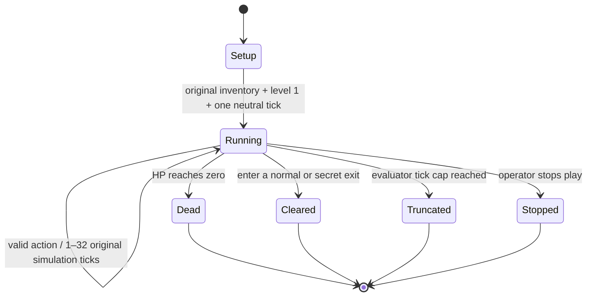

AI-use disclosure: Codex inspected the manual/source, added rule checks, and recorded the October 19, 2026 acceptance replay under the student's direction.

# Catacomb II: bounded rules, state and decisions

## Evidence and scope

Manual: local original `data/original/INSTRUCT.TXT`, sections **Summary of how to play** and **Controlling Play**. Source: [CatacombSDL, commit 473d1362](https://github.com/Blzut3/CatacombSDL/tree/473d13629a2350e2498dd4a158e5bd0b36184160). The manual supplies intended behavior; source supplies exact counters and update rules. See [provenance](ASSET_PROVENANCE.md) for reuse terms.

Scope: **original level 1, fresh-game inventory, normal movement/combat/pickups, death or any original exit ends the episode**. A secret exit also counts as leaving this level. This matches the student's September 26 Week 3 proposal; see [SCOPE.md](SCOPE.md) for the record of origin and reasons for every exclusion/adaptation.

## State diagram



`Truncated` is an evaluator outcome, not an original game rule or a win. Observation remains available after termination; further steps are rejected. Process quit/EOF ends the session without another observation.

## State that a decision changes

| State | Initial / transition | Player knowledge |
| --- | --- | --- |
| Body points | 13 initially; damage reduces them; potion can restore them; zero ends play | Body bar, not an extra numeric field |
| Inventory | Keys 0; potions 3; bolts 3; nukes 2 | Existing HUD |
| Position / facing | Original start; movement obeys collision; strafe preserves facing | Current picture; no coordinate API |
| Shot power | 0–13; hold fire charges, release fires | Existing power meter |
| Map / doors | Walls block; a key opens a connected locked-door segment; some walls are destructible | Only what the original current picture shows |
| Enemies / projectiles | Original activation, movement, attacks and collisions | Visible sprites; no hidden object list |
| Episode clock | Starts at tick 1; only valid actions advance it | Tick metadata explicitly supplied |

## Annotated source excerpts

From `catacomb.c`, `playsetup` (initial-state excerpt, formatting condensed):

```c
o[0].hp = 13;
givenuke(); givenuke();
givebolt(); givebolt(); givebolt();
givepotion(); givepotion(); givepotion();
```

Annotation: fresh episodes use the same starting state. Reset belongs to the evaluator, so a player cannot refill inventory by resetting during an episode.

From `cat_play.c`, `playercmdthink` (branch excerpt, display updates omitted):

```c
if (c.button1) {
    if (shotpower == 0) shotpower = 1;
    else if (shotpower < 13 && frameon % 2) shotpower++;
} else if (shotpower > 0) {
    if (shotpower == 13) playbigshoot();
    else playshoot();
    shotpower = 0;
}
```

Annotation: holding and releasing are distinct decisions. “Shoot” cannot be replaced with an automatic damage command. Movement, active bolt spells and player delays still affect when the original routine samples controls.

## Rule/source/acceptance map

Inherited-rule evidence labels are `code`, `manual`, `observed`, and `assumed`. Deliberately chosen rules/adaptations use `design` and point to [DESIGN_SPEC.md](DESIGN_SPEC.md) with their rationale. Manual sections corroborate intended controls; recorded play supports only the behavior actually exercised. File/line locators refer to the source at `1d2e626` (runtime unchanged by this audit). A `design` row's code locator verifies implementation, not original-game authorship.

| Rule | Strongest evidence | Origin and exact locator | Acceptance or limitation |
| --- | --- | --- | --- |
| Initial HP 13, inventory and zero score | code | Original: `catacomb.c:611`, `playsetup` | Initial HUD and source inspection; fresh process for each episode |
| Movement, collision and strafing/facing | code | Original: `cat_play.c:771`, `walk`; `cat_play.c:857`, `playercmdthink`; manual **Controlling Play** | Native floor/wall and demo-input strafe checks; full exit replay |
| Fire charging, small/large shot and release | code | Original: `cat_play.c:857`, `playercmdthink`; `cat_play.c:337`, `playshoot`; `cat_play.c:376`, `playbigshoot` | Native charge/release checks and real frames at ticks 81, 113, 121 |
| Pickups, keys and connected locked doors | code | Original: `cat_play.c:621`, `walkthrough`; `cat_play.c:157`, `givekey`; `cat_play.c:205`, `takekey`; `cat_play.c:418`, `opendoor` | Pickup, no-key blockage and connected-door one-key fixtures |
| Contact/projectile damage, healing and death | code | Original: `cat_play.c:473`, `tagobject`; `cat_play.c:542`, `intomonster`; `cat_play.c:229`, `takepotion` | Lethal damage, healing and empty-inventory fixtures; exit replay did not need healing |
| Bolt/nuke consumption and projectile creation | code | Original: `cat_play.c:252`, `castbolt`; `cat_play.c:275`, `castnuke` | Bolt shot count, empty inventory and 12-projectile nuke fixtures; real route uses one nuke |
| Destructible walls and revealed pickups | code | Original: `cat_play.c:621`, `walkthrough` | Blockage, small-shot destruction, big-shot continuation and hidden-key reveal fixtures |
| Enemy properties, activation, pursuit and attacks | code | Original: `objects.c:31` onward, object definitions; `cat_play.c:1125`, `chasethink`; `cat_play.c:1240`, `gargthink`; `cat_play.c:1299`, `dragonthink`; `cat_play.c:1386`, `shooterthink`; `cat_play.c:1497`, `think`; `cat_play.c:1532`/`1566`, activation | Reused source and bounded real runs; no per-enemy original-DOS equivalence claim |
| Score from kills and treasure | code | Original: `cat_play.c:501`, kill points; `cat_play.c:743`, treasure; `objects.c:31` onward, point values | Source-located; current evaluation reports completion, not a parsed numeric HUD-score metric |
| Normal exit and secret warp | code | Original: `cat_play.c:542`, `intomonster`; `cat_play.c:119`, `levelcleared` | Normal/warp fixtures; ordinary-interface exit at tick 612; parser termination repaired in this project |
| Paused/fixed-step updates and startup tick | design | [Specification D2](DESIGN_SPEC.md#d2-time-and-controls); `catasm.c:118`, `GameTick`; `agent_bridge.c:141`, `AgentRun` | Invalid requests/observe do not step; first image is tick 1; disclosed pacing adaptation |
| Allowed action vocabulary and malformed-input rejection | design | [Specification D2/D4](DESIGN_SPEC.md#d2-time-and-controls); `agent_protocol.c:28`, `AgentParseCommand`; `scripts/catacomb_env.py:41`, `Action.command` | Protocol/client tests cover legal/illegal fields, 1–32 ticks and at most one consumable |
| Status, evaluator cap and post-terminal behavior | design | [Specification D1/D4](DESIGN_SPEC.md#d1-bounded-level-and-outcome); `agent_bridge.c:96`, `episode_status`; `agent_bridge.c:141`, `AgentRun` | Cap-9 integration truncates at 9; no post-terminal step; original death/exit remains distinct |
| Pixel-only player view and no model audio | design | [Specification D3](DESIGN_SPEC.md#d3-observation-boundary); `agent_bridge.c:105`, `observation`; `scripts/player_contract.py:54`, `PlayerContext`; `scripts/vertex_player.py:22`, `VertexPlayer` | Allowlist/history tests; no source/debug fields or registered model tools |
| Reachable prepared starts, relative player clock and binary task score | design | [Specification D5](DESIGN_SPEC.md#d5-declared-situation-evaluation), [declared situations](SITUATIONS.md), `config/situations-v2.json`; `scripts/situation_env.py`, `SituationEnv.reset`, `step`, `outcome` | Reset by legal control prefix; preparation excluded from player history/budget; score 1 only for original level exit; offline and real-resource tests in `tests/test_players_situations.py` and `tests/test_live_game.py` |

Function locators identify the new adapter without implying changes to the
native line locators above. No undocumented gameplay inference is presented as
a verified original rule. New source-game inferences receive `assumed`;
intentional choices receive `design` and a specification.

Native tests execute the real rule functions with controlled fixtures. They are distinct from real-resource process tests and original-DOS fidelity comparisons.

## Core loop

```text
load original resources and first level
    → return original rendered image
    → wait for a permitted action (world paused)
    → validate the entire request
    → apply controls for the requested ticks
        → original object update order
        → movement, collision, attacks, pickups, enemies
        → death / exit / evaluator cap check
    → render and return image + status + ticks
```

`catasm.c: GameTick` is the extracted original iteration; human mode calls it continuously. Agent mode calls it in bounded batches. The rules are reused while interaction pacing changes. Model and baseline must use the same stepping, actions, observations and budget. Version 1 excludes audio from player observations.

## Actual short trace

Local evidence: `runs/week4-verified-20261012/trace.jsonl` and `demo.json`.

| Tick | Input just executed | What the image can establish |
| --- | --- | --- |
| 1 | Initial neutral tick | Real map/HUD/player drawn |
| 33, 65 | South 32, then South 32 | Movement changes the camera view |
| 81 | East 16 | Direction changes before firing |
| 113 | Hold fire 32 | Power meter charges |
| 121 | Release 8 | Meter resets and projectile appears |
| 129 | Nuke 8 | Spell projectiles and reduced inventory |
| 161, 177 | South + charge 32, then release 16 | Movement and attack continue without a protocol crash |

Final status: `running`. This demonstrates the interface, not a completed level or competent agent play.

## Reuse and changes

### Full-level acceptance, October 19

`scripts/record_acceptance.py` discovered a route using read-only developer state
and replayed all 303 actions through the ordinary debug-disabled API. Both runs
reached the original exit at tick 612. The discovery run ended with 13 HP, one
key and one nuke remaining. No teleport, inventory edit, invulnerability, enemy
freeze or rule alteration was used. The replay record and resource/build hashes
are in `docs/evidence/level1-acceptance-20261019.json`; the reproducible action
fixture is `config/acceptance-route.json`. `tests/test_live_game.py` checks this
route when local resources are supplied.

This is an acceptance fixture with privileged route knowledge. It is excluded
from model prompts and baseline comparisons. Tests of the reused source are not
a controlled original-DOS executable comparison; that limitation remains.

Reused: upstream C simulation, graphics, audio and normal keyboard gameplay. Added: bounded lifecycle, strict action protocol, PNG adapter, logs and headless execution. Fixed: Windows binary resource flags, startup argument parsing, and the warp-number parser's missing string termination. Resource artwork and core gameplay rules were not redesigned.
